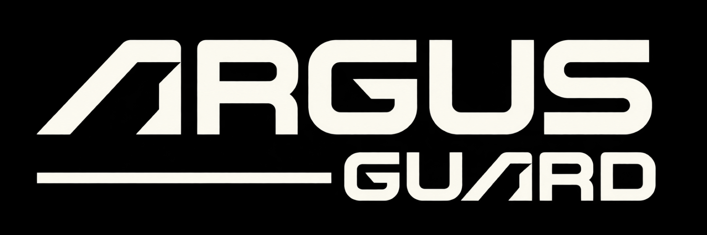
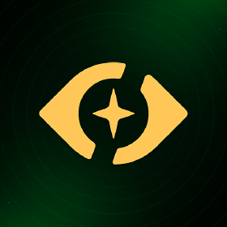

<!--
  EXIT • GitHub Profile
  Desenvolvido para Luiz / Argus Corps
  As imagens estão na mesma pasta do README para facilitar a instalação.
  Repositório de perfil: crie um repositório público com o mesmo nome do seu usuário.
-->

  
<strong>SOFTWARE DEVELOPER &nbsp;·&nbsp; ARGUS CORPS</strong>

  
  
Desenvolvendo tecnologia para <strong>proteger, automatizar e evoluir</strong> experiências digitais.

  

    
    
    
  

---

### `> sobre mim`

Sou **Exit**, desenvolvedor da **Argus Corps**. Meu trabalho é transformar ideias em soluções digitais, com atenção à **segurança**, à **automação** e à **experiência de quem utiliza o produto**.

Na Argus Corps, desenvolvi projetos em duas frentes principais: **Argus Guard**, voltado à proteção de servidores FiveM, e **Argus Bots**, dedicado a bots e automações para comunidades do Discord.

### `> projetos desenvolvidos`

<table>
  <tr>
    <td width="56%" align="center" valign="middle">
      
    </td>
    <td valign="middle">
      <h3>🛡️ ARGUS GUARD</h3>
      
<strong>Security for FiveM</strong>

      
Projeto de segurança desenvolvido para proteger servidores FiveM, reunindo soluções de <strong>anti-cheat</strong> e <strong>anti-dumper</strong>.

      
    </td>
  </tr>
  <tr>
    <td width="56%" align="center" valign="middle">
      
    </td>
    <td valign="middle">
      <h3>🤖 ARGUS BOTS</h3>
      
<strong>Automation for Communities</strong>

      
Projeto voltado ao desenvolvimento de <strong>bots e sistemas de automação para Discord</strong>, com foco em organização, gestão e experiências para comunidades.

      
    </td>
  </tr>
</table>

### `> stack & ecossistema`

  
  
  
  
  
  
  
  
  
  
  
  
  
  
  
  
  
  
  

 

  BUILT WITH PURPOSE. SECURED BY DESIGN.
   
  <strong>EXIT × ARGUS CORPS</strong>

